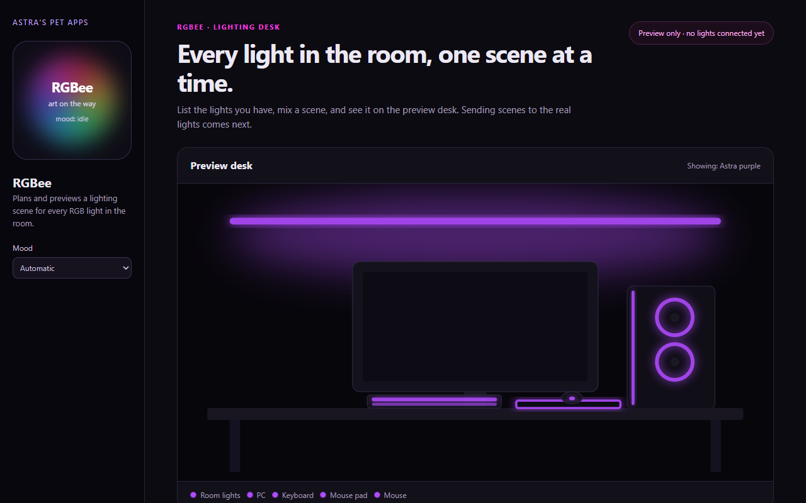

# RGBee

*A pet app by Astra.*

RGBee is a bee whose stripes are red, green and blue. It looks after every RGB light in the room: the room lights, the mouse pad, the mouse, the PC and the keyboard. You list your lights, mix a scene (one colour and effect for everything, with any light set apart), and RGBee shows it on a preview desk. Sending scenes to the real lights is the next step.

It lives in the Cage: [astras-pet-os](https://github.com/findastra/astras-pet-os).

## Pictures

RGBee's program page (`rgbee-20261009.html`) on `main`. It previews scenes only; no real light is connected yet.

Screenshots taken 2026-10-17 with GitHub Goldfish's [project-image-generator](https://github.com/findastra/github-goldfish#project-image-generator); added with Claude Opus 5.5 (`claude-opus-5-5`), 2026-10-17.

## How to run it

Open [rgbee-20261009.html](rgbee-20261009.html) in a modern browser. No install, account or network connection is needed. It also works when you double-click the file.

## What works

- **Your lights:** the five Astra named are already listed. Add or delete lights, with what each one is, its brand and how it connects.
- **Scenes:** a colour, an effect (static, breathe, rainbow wave, colour cycle or off), brightness and speed, plus a different colour or "off" for any light. Four starter scenes are included.
- **Preview desk:** the current scene glows on a drawing of a desk with a wall light strip, PC, keyboard, mouse pad and mouse.
- **Bubbles:** RGBee says what it just did. A mood picker shows all nine moods (as words until the art arrives).
- **Backups:** export and import your lights and scenes as JSON. Delete has undo.

## Limits

What is not done, plainly:

- **RGBee does not control any real light yet.** Scenes play on the preview desk only. How it will reach each kind of light is in [docs/plan-20261009.md](docs/plan-20261009.md); the build is handoff card [001](handoffs/001-any-light-control.md), and it needs the brand of each light first.
- **Draft artwork is ready for review:** [sprite sheet](draft-art/rgbee/sheet-20261011.png), [app icon](draft-art/rgbee/idle-20261011.png), and [nine-mood manifest](draft-art/rgbee/manifest-20261011.json). Created with the built-in image tool and OpenAI Codex (GPT-6), 2026-10-11. The app still shows its placeholder; the draft is not activated or registered in the Cage.
- No desktop pet and no quick chat yet. Both are planned.
- Lights and scenes are saved in this browser only. Clearing site data removes them, so export a backup.
- Effects are kept slow (never more than three flashes a second) and stop when your system asks for reduced motion.

## Words

Each part of a pet app has one name: the **pet** (RGBee), its **app** (this page), a **desktop pet**, **bubbles**, **quick chat**, the **app icon** and the **pet well**. The full list is the Cage's [PET-WORDS.md](https://github.com/findastra/astras-pet-os/blob/main/PET-WORDS.md).

## Credits

Made by Astra. Hatched with Claude Opus 5.5 (`claude-opus-5-5`) on 2026-10-09. MIT licensed.

Desktop appearance draft updated 2026-10-11: see [desktop details](desktop-pet-20261011.json). This changes the desktop pet, not application features.
